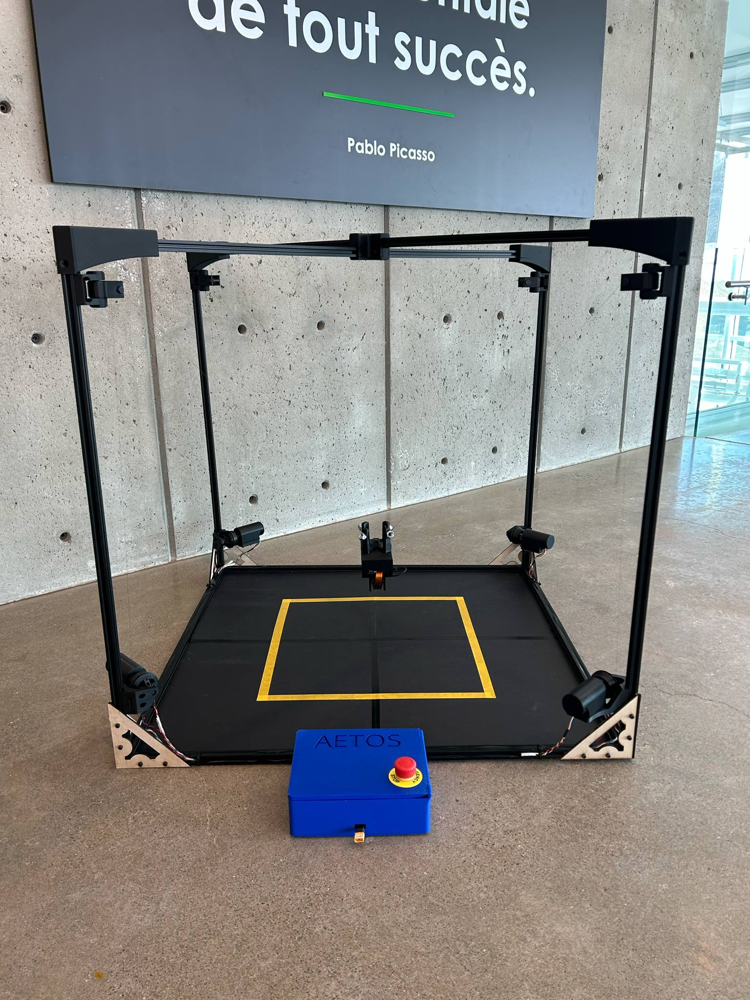
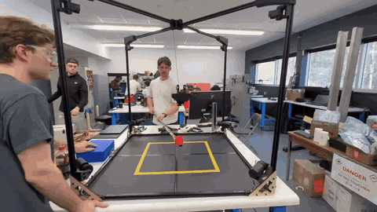
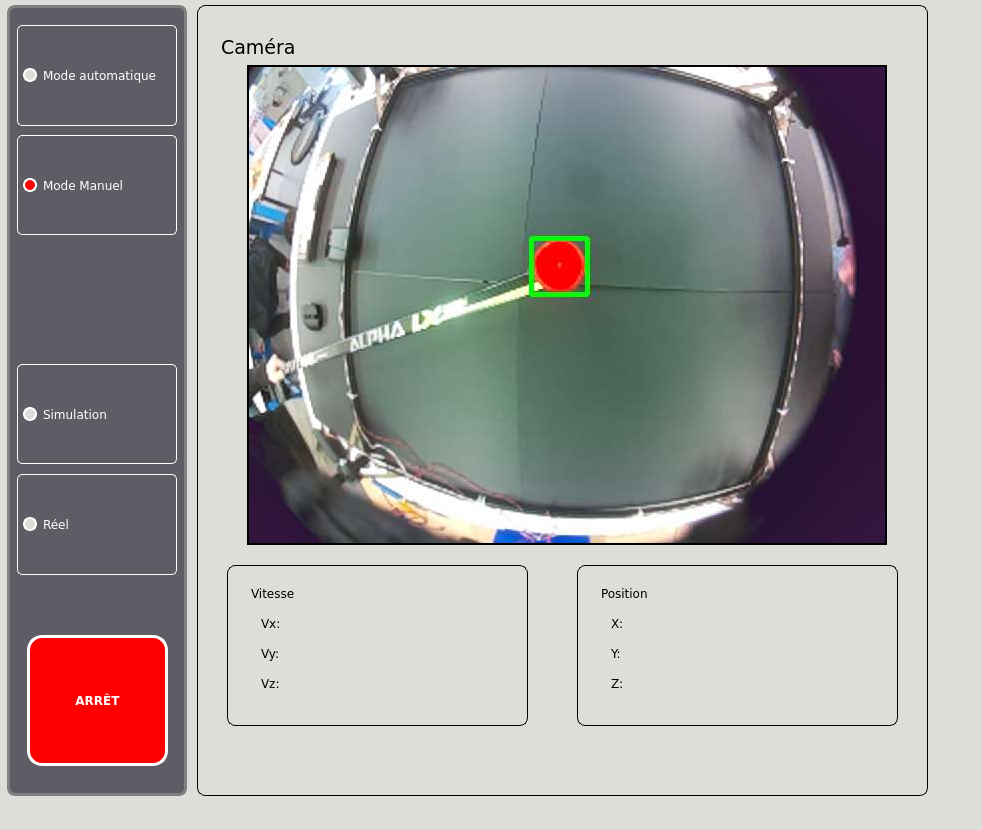
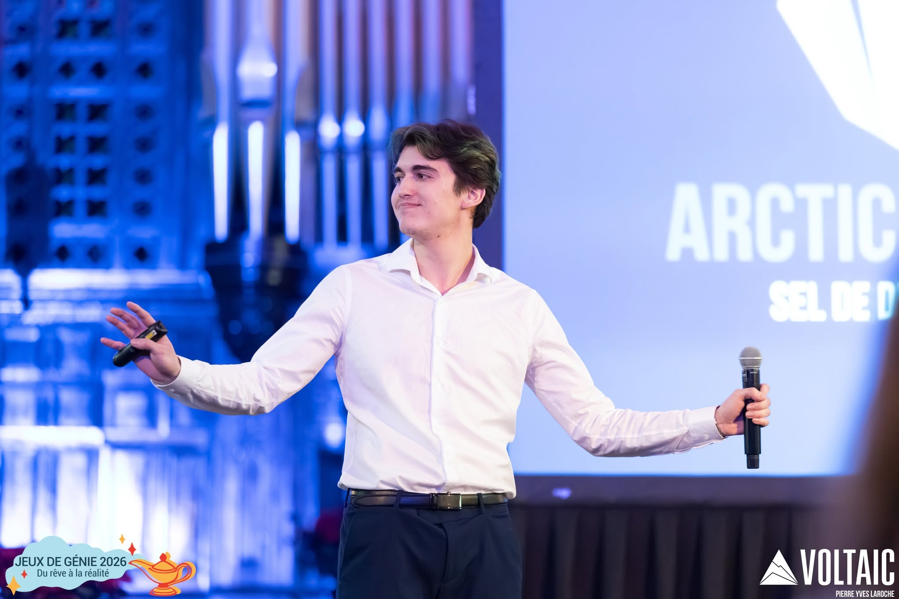
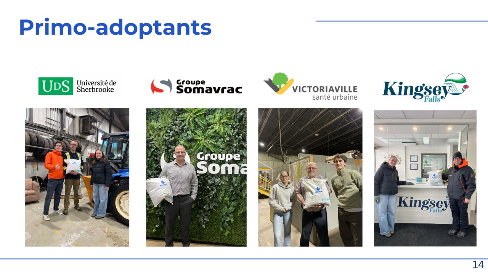
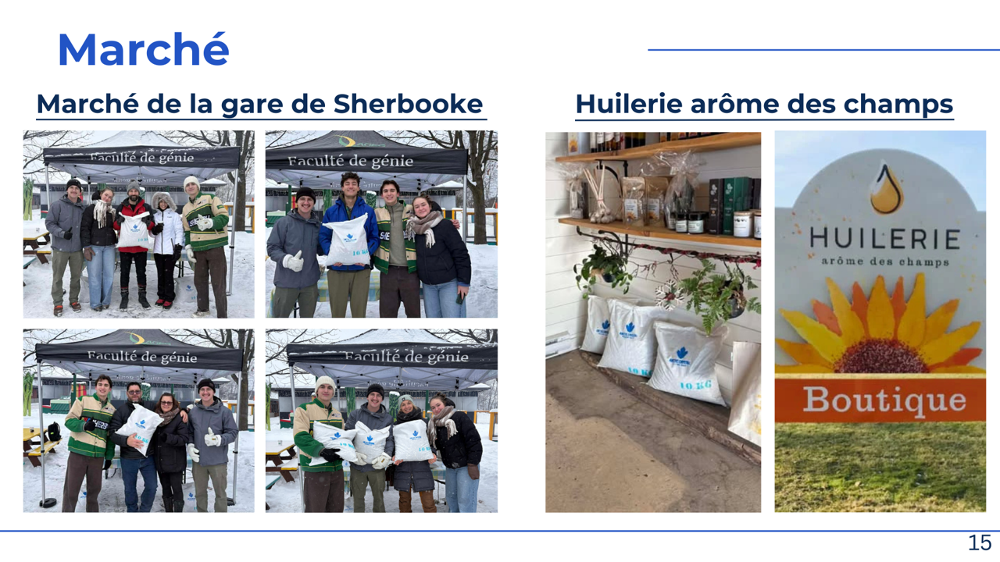

# Nikolay Papanchev

Hello and welcome to my portfolio!

I am a robotics engineering student in the co-op program at Université de Sherbrooke, graduating in December 2027. I enjoy working on embedded software and mechanical design, and I like seeing a system run on real hardware. I am especially interested in mobile robots and autonomous vehicles.

I am looking for a robotics or embedded software internship for summer 2027, available from May to August.

This portfolio presents my school projects and extracurricular involvement.

My professional experience is detailed in my resume. In short: 4 internships, including 2 at General Dynamics Mission Systems – Canada, one installing robotic palletizing cells at BeRobox, and one in biomedical sensor research at Créatek.

---

## Projects

### ECHO Robotics: hybrid robotic glove (capstone project)
**Role:** embedded software and test bench · Team of 8 · May 2026 – present

Pictures will follow once the project is complete!

#### The idea

ECHO is a haptic robotic glove mounted as a payload on a robot arm. The goal is to teach a robot a task by showing it: you make the movement with your own hand, the glove records it, and the arm then reproduces it. The hard part is that it must reproduce not only the position of the fingers, but also the *forces* you applied. For the final demonstration, we would like the glove to pick up an egg, which would show that it controls force as well as position.

#### Why MR clutches

To control force precisely and quickly, the glove uses magnetorheological (MR) clutches instead of driving each finger directly with a motor and gearbox.

An MR clutch contains a fluid filled with tiny iron particles. When current flows in the clutch's coil, the magnetic field lines the particles up and the fluid thickens, so the clutch transmits more torque. A motor drives the input side of the clutch, and the coil current decides how much of that torque reaches the output. The output pulls on a cable that bends the finger.

#### What I have worked on so far

**1. BLDC motor driver and hardware abstraction layers (HAL)**

I wrote the driver for the BLDC motors, which are commanded through Maxon ESCON controllers. It is built on hardware abstraction layers that separate the application code from the hardware: the rest of the firmware talks to a generic motor interface and never touches the STM32 peripherals directly, so it can be reused or moved to other hardware without being rewritten.

The interfaces are defined with C++ concepts. If an implementation doesn't respect its interface, the code doesn't compile, so errors are caught at compile time instead of showing up while the glove is running.

**2. Force test bench**

- **Goal:** measure the system's bandwidth, meaning how fast the force at the fingertip follows a command sent to the clutch. This is needed before designing the force and position control loop.
- **My part:** the load-cell firmware, and especially how the force reading is averaged.

Averaging many samples gives a more precise force reading, but computing the average in software keeps the CPU busy with every sample. We moved that work into the STM32's hardware instead:

- a timer triggers an ADC conversion at a fixed rate (10 kHz);
- the ADC's built-in hardware oversampler adds up 1,000 conversions by itself, without the CPU;
- the CPU only reads one sum every 100 ms and divides it once.

This lets us average far more samples (1,000 per reading, at 16-bit resolution) while leaving the CPU free. The 100 ms window was also chosen on purpose: it covers a whole number of power-line cycles (6 at 60 Hz, 5 at 50 Hz), so the electrical noise from the mains averages out instead of showing up as a slow drift in the measurement.

#### Status

The project is in progress. The current step is measuring the system's bandwidth on the test bench. The next step is to use those results to design the force and position control loop on the full glove.

---

### SkyCam: cable-driven 3D camera robot (4th-semester project)
**Role:** teleoperation, kinematics and simulation · Team of 6 · Jan – Apr 2025

#### The idea

Aetos is our small-scale version of the "SkyCam" systems used above sports stadiums: a camera hangs from 4 cables attached to the top corners of a frame (about 1 m × 1 m × 1 m). Each cable is wound on a winch driven by a motor. By changing the length of each cable at the right speed, the camera can move anywhere in 3D inside the frame. The robot can be driven manually with a controller, or follow a target on its own using its camera.

The software runs on ROS 2 inside a Docker container. An ESP32 drives the motors and reads their encoders.

*The camera moving inside the frame.*

#### What I worked on

**1. Kinematics**

The operator thinks in terms of camera velocity (move left, up, forward), but the robot can only change cable lengths. I worked on the math that connects the two:

- **Forward kinematics:** the encoders give each winch's angle, which gives the length of each cable. From these lengths, the code computes the camera's position in the frame.
- **Inverse kinematics:** a 4 × 3 Jacobian matrix converts the desired camera velocity into the speed at which each of the 4 cables must be wound or unwound, then into a speed for each motor. Each row of the matrix is simply the direction of one cable, from its anchor point to the camera.
- **Speed limit:** if one motor would have to turn faster than its maximum, all 4 speeds are scaled down by the same ratio, so the camera slows down but keeps going in the right direction.

**2. Teleoperation**

The robot is driven with an Xbox controller. Two details make it safer and smoother:

- a dead-man button must be held for any command to be sent; releasing it stops the robot;
- the velocity is ramped with a maximum acceleration, so the camera starts and stops smoothly instead of jerking on its cables.

A safety check also stops the camera before it gets within 10 cm of the edges of the frame.

**3. Simulation**

To test the kinematics without risking the hardware, I worked on a 3D simulation in Python. It receives the same motor commands as the real robot, integrates them into simulated encoder values and sends them back, so the full control loop runs without any motor connected. A 3D view shows the camera and its 4 cables moving in real time, which made it easy to spot errors in the math before testing on the real robot.

**4. User interface (smaller part)**

I also helped with the Qt interface, which shows the camera feed, the camera's position and velocity, lets the operator switch between manual and automatic modes or between simulation and the real robot, and includes a software emergency stop.

#### Result

The robot moves in 3D across its 1 m³ workspace, driven by the operator or in simulation.

---

### De-icing salt startup (Quebec Engineering Games)
**Role:** team captain, entrepreneurship competition · Team of 5 · Jeux de Génie 2026

This one is not a robotics project. It is here because it shows another side of how I work: leading a team, talking to clients and convincing a room.

*Pitching at the Jeux de Génie 2026 (photo: Pierre-Yves Larose / Voltaic).*

#### The competition

The Quebec Engineering Games (*Jeux de Génie du Québec*) are the largest engineering competition in the province, bringing together 14 universities from Quebec, Ontario and the Maritimes. One of its biggest events is the entrepreneurship competition: each team has 4 months, from September to December, to build a startup from scratch, then pitches it to a jury of entrepreneurs in front of 500 people in the stands.

Our team fell short of the title in 2025. For 2026, I was named team captain.

#### The problem we chose

In Quebec, roads are covered in de-icing salt every winter. It works, but it damages roads and infrastructure, and it is harmful to the environment. We wanted a product that would keep roads safe while using less salt.

#### What we built in 4 months

- **The product:** a new de-icing mix made of recycled sunflower seed hulls combined with salt and calcium chloride.
- **A local supply chain:** the hulls came from a local farm, which also became one of our points of sale.
- **Real customers:** 4 early adopters bought our product to test it (Université de Sherbrooke, Groupe Somavrac, Victoriaville and Kingsey Falls), and 25 people bought a bag of it.
- **The pitch:** we presented the startup to the jury and an audience of 500 people.

*Our early adopters, from the slides of our pitch.*

*Selling our product at the Marché de la gare de Sherbrooke and at the Huilerie Arôme des champs, the farm that supplied the sunflower hulls.*

#### Result

**1st place** in the entrepreneurship competition of the Jeux de Génie 2026.

